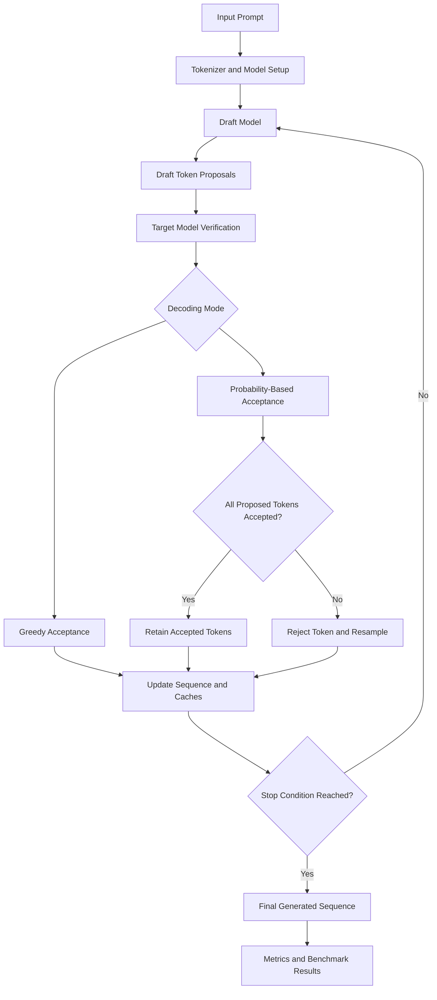

# SpecMatch

### A From-Scratch Speculative Decoding Engine for Causal Language Models

SpecMatch is an experimental speculative decoding engine built to study how a smaller draft language model can accelerate autoregressive generation by proposing multiple tokens that a larger target model verifies in a single forward pass.

The project implements the core speculative decoding workflow, including draft generation, target verification, token acceptance and rejection, residual-distribution sampling, KV-cache management, benchmarking, and experiment analysis.

Rather than treating speculative decoding as a black-box optimization, SpecMatch focuses on understanding the algorithm, implementing its critical components, validating correctness, and measuring whether the optimization actually improves generation performance on different workloads and hardware.

The project currently uses GPT-2 as the target model and DistilGPT-2 as the draft model. It has been tested on an Intel Arc XPU environment, alongside earlier CPU experiments.

**Repository:** [Anirudh2627/Specmatch](https://github.com/Anirudh2627/Specmatch)

---

## Table of Contents

- [Overview](#overview)
- [Why Speculative Decoding?](#why-speculative-decoding)
- [What SpecMatch Implements](#what-specmatch-implements)
- [System Architecture](#system-architecture)
- [How Speculative Decoding Works](#how-speculative-decoding-works)
- [Architectural Decisions](#architectural-decisions)
- [Engineering Challenges and Solutions](#engineering-challenges-and-solutions)
- [Benchmarking Methodology](#benchmarking-methodology)
- [Experimental Results](#experimental-results)
- [Project Structure](#project-structure)
- [Installation](#installation)
- [Usage](#usage)
- [Running Benchmarks](#running-benchmarks)
- [Analyzing Results](#analyzing-results)
- [Testing and Validation](#testing-and-validation)
- [Limitations](#limitations)
- [Future Work](#future-work)
- [References](#references)

---

## Overview

Autoregressive language models generate text one token at a time. Each new token generally requires another forward pass through the target model, creating a sequential generation bottleneck.

Speculative decoding attempts to reduce this bottleneck by introducing a smaller draft model.

The draft model proposes several tokens. The target model then evaluates those proposals together, allowing multiple tokens to be accepted from a single target-model verification pass.

The central idea is simple:

- Use a smaller model to propose candidate tokens.
- Use the target model to verify those candidates.
- Accept valid proposals according to the appropriate sampling rule.
- Reject invalid proposals and recover using the target distribution.
- Continue generation from the resulting sequence.

The difficulty lies in implementing this correctly. Acceptance decisions, probability distributions, KV-cache positions, stopping conditions, and timing measurements must all remain consistent.

SpecMatch explores these engineering details through an implementation, automated tests, and reproducible benchmark experiments.

### Project goals

1. Implement the core speculative decoding algorithm rather than relying entirely on a high-level speculative decoding library.
2. Preserve the intended target-model generation distribution through the appropriate acceptance and correction rules.
3. Manage target and draft model caches correctly as tokens are accepted, rejected, or truncated.
4. Compare baseline autoregressive generation against speculative generation.
5. Evaluate the effect of draft length, prompt characteristics, and accelerator execution on performance.
6. Build a testable experimental codebase with structured results and analysis tools.

---

## Why Speculative Decoding?

Standard autoregressive generation follows this pattern:

```text
Prompt
  |
  v
Target model
  |
  v
Generate one token
  |
  v
Update context and cache
  |
  v
Target model again
  |
  v
Generate the next token
```

The target model must repeatedly execute its forward pass to generate subsequent tokens.

Speculative decoding changes the execution pattern:

```text
Prompt
  |
  v
Draft model
  |
  v
Propose multiple tokens
  |
  v
Target model verifies proposals
  |
  v
Accept valid prefix / correct rejection
  |
  v
Continue generation
```

This can improve throughput when the cost of drafting several tokens is lower than the target-model computation saved by verifying them together.

However, speculative decoding is not automatically faster.

Its performance depends on factors such as:

- Draft-model inference latency.
- Target-model inference latency.
- Draft acceptance rate.
- Number of speculative tokens proposed per iteration.
- Prompt and output lengths.
- Model architecture and cache behavior.
- Hardware execution overhead.
- Synchronization and measurement methodology.

SpecMatch measures these trade-offs instead of assuming that a higher acceptance rate necessarily means faster generation.

---

## What SpecMatch Implements

| Component | Responsibility |
|---|---|
| Baseline generation | Autoregressive generation using the target model |
| Draft generation | Proposes candidate tokens using the smaller model |
| Target verification | Evaluates proposed tokens with the target model |
| Greedy decoding | Supports deterministic acceptance and rejection |
| Sampling-based decoding | Uses probability-based acceptance and correction |
| Residual resampling | Samples from the appropriate correction distribution after rejection |
| KV-cache management | Tracks cached tokens and maintains cache consistency |
| Benchmark harness | Runs baseline and speculative generation experiments |
| Benchmark metrics | Calculates throughput, latency, acceptance, and speedup statistics |
| Result analysis | Compares configurations and paired prompt-level performance |
| Automated tests | Validates important algorithmic and infrastructure behavior |

The project is designed to separate the decoding algorithm from the benchmarking and analysis layers, making individual components easier to test and reason about.

---

## System Architecture



### Main execution stages

**1. Model initialization**

Load the target model and draft model, configure the tokenizer, select the execution device, and prepare the generation configuration.

**2. Draft proposal**

The draft model generates a configurable number of candidate tokens. The number of speculative tokens is controlled by `K`.

**3. Target verification**

The target model evaluates the candidate sequence in a forward pass. Its probability distributions are used to determine which proposed tokens can be retained.

**4. Acceptance and correction**

The decoding algorithm accepts the longest valid prefix under its acceptance rules. If a proposal is rejected, the implementation uses the appropriate correction distribution for the decoding mode.

**5. Cache and sequence updates**

The generated sequence and model caches are updated to reflect the tokens actually consumed by the decoding algorithm.

**6. Termination**

Generation stops when the configured output limit or another applicable stopping condition is reached.

**7. Measurement and analysis**

The benchmark harness records performance metrics, saves experiment results, and supports comparison between baseline and speculative generation.

---

## How Speculative Decoding Works

This section describes the algorithmic principles behind SpecMatch.

### 1. Draft token generation

Let the current context be \(x\). The draft model proposes \(K\) tokens:

\[
y_1,y_2,\ldots,y_K
\]

Each token is sampled or selected using the draft model's distribution, depending on the decoding mode.

The proposed tokens extend the context used for verification.

### 2. Target-model verification

The target model evaluates the proposed sequence and produces the corresponding target distributions:

\[
p_1,p_2,\ldots,p_K
\]

The draft model provides its proposal distributions:

\[
q_1,q_2,\ldots,q_K
\]

The target model can evaluate multiple candidate positions in one forward pass, subject to the model's attention mask and cache configuration.

This is the central computational advantage of speculative decoding: several candidate tokens can be checked together rather than requiring an independent target-model generation pass for every token.

### 3. Greedy acceptance

Under greedy decoding, the target model selects the token with the highest probability at each position.

A draft token is accepted when it matches the target model's greedy choice at that position. Verification continues until a mismatch or the end of the proposed sequence.

After a rejection, generation continues from the target model's appropriate token.

Greedy acceptance is comparatively straightforward because the target's next-token decision is deterministic for a fixed context and model configuration.

### 4. Sampling-based acceptance

For sampling-based speculative decoding, matching the target model's most likely token is not sufficient. The goal is to preserve the target model's sampling distribution.

For a proposed token \(y_i\), the acceptance probability is:

\[
\alpha_i =
\min\left(1,\frac{p_i(y_i)}{q_i(y_i)}\right)
\]

The proposal is accepted with probability \(\alpha_i\).

This acceptance rule accounts for differences between the draft and target distributions.

### 5. Residual resampling

If a draft proposal is rejected, the algorithm must produce a correction token according to the target distribution after accounting for the draft proposal.

The residual distribution is:

\[
r_i(v) \propto
\max\left(0,p_i(v)-q_i(v)\right)
\]

When the residual has positive total mass, it is normalized and used to sample the correction token.

This correction step is essential. Simply discarding a rejected token and sampling an arbitrary replacement would not, in general, preserve the target model's intended distribution.

### 6. Cache consistency

KV caches store intermediate attention keys and values so that previously processed tokens do not need to be recomputed unnecessarily.

Speculative decoding introduces additional cache-management requirements:

- The draft model may process tokens that are later rejected.
- The target model may verify several positions beyond the final accepted prefix.
- Cache lengths must correspond to the actual consumed sequence.
- Rejected speculative positions must not remain as part of the committed decoding state.
- The next iteration must use the correct context and cache positions.

Incorrect cache updates can produce subtle errors even when the acceptance logic appears correct.

SpecMatch treats cache handling as part of the decoding algorithm rather than an incidental implementation detail.

---

## Architectural Decisions

The following decisions shape the implementation and the experiments.

### 1. Implement the decoding logic directly

**Decision:** Build the core speculative decoding workflow inside the project instead of treating a high-level speculative decoding API as the entire implementation.

**Reasoning:**

- Makes acceptance and correction behavior inspectable.
- Allows targeted tests for decoding edge cases.
- Exposes the interaction between model execution and KV-cache state.
- Makes it easier to experiment with different speculative-token counts.

**Trade-off:** Implementing the algorithm directly introduces additional correctness responsibilities, especially around sampling distributions, cache updates, and stopping conditions.

### 2. Separate generation from benchmarking

**Decision:** Keep generation behavior and benchmark orchestration in separate modules.

**Reasoning:**

- Generation code can be tested independently of timing.
- Benchmark changes do not need to modify the core decoding algorithm.
- Multiple experiments can reuse the same generation implementations.
- Performance measurement logic can be improved without changing decoding semantics.

This separation is particularly important because an implementation can be algorithmically correct while its benchmark methodology is still misleading.

### 3. Support both greedy and sampling-based decoding

**Decision:** Treat deterministic decoding and probability-based decoding as distinct execution modes.

**Reasoning:**

Greedy decoding is useful for checking token-level agreement and deterministic behavior. Sampling-based decoding introduces probability ratios, stochastic acceptance, and residual correction.

Keeping these cases distinct makes their assumptions and correctness requirements easier to test.

### 4. Treat KV-cache management as a correctness requirement

**Decision:** Explicitly handle cache state as speculative tokens are accepted or rejected.

**Reasoning:**

The target model and draft model can temporarily process tokens that do not belong to the final committed sequence. Those positions must not be incorrectly reused in later decoding iterations.

The implementation and tests therefore pay attention to cache lengths, consumed positions, and truncation behavior.

### 5. Synchronize accelerator execution around timing

**Decision:** Synchronize supported accelerator devices around timed generation sections.

**Reasoning:**

Accelerator operations can execute asynchronously. Measuring only the time required to enqueue operations can underestimate the actual computation time.

Synchronization makes the measured interval more representative of completed generation work.

**Trade-off:** Synchronization adds measurement overhead. That overhead must be applied consistently to the paths being compared.

### 6. Warm up generation paths before measurement

**Decision:** Warm up the requested generation modes before collecting benchmark measurements.

**Reasoning:**

Initial execution can include one-time costs such as kernel initialization, compilation, memory allocation, and other runtime setup.

Warming up reduces the risk that startup overhead disproportionately affects one configuration.

Warm-up does not eliminate all sources of variation, so repeated measurements remain necessary.

### 7. Interleave baseline and speculative measurements

**Decision:** When both modes are benchmarked together, run them in an interleaved sequence and alternate their order.

**Reasoning:**

Running every baseline measurement first and every speculative measurement afterward can introduce order-dependent bias from thermal behavior, runtime state, and background activity.

Interleaving makes the comparison more balanced, although it cannot eliminate every source of noise.

### 8. Measure aggregate throughput as well as mean throughput

**Decision:** Report aggregate token throughput alongside the mean of individual run throughputs.

Aggregate throughput is calculated as:

\[
\text{Aggregate throughput} =
\frac{\sum_i \text{new tokens}_i}
{\sum_i \text{wall time}_i}
\]

Mean throughput instead averages the throughput of individual runs.

These metrics answer different questions. Aggregate throughput describes the combined measured workload, while mean throughput gives equal weight to each individual run.

The distinction matters when prompts generate different numbers of tokens or have different execution times.

### 9. Compare configurations using matched prompts

**Decision:** Analyze baseline and speculative runs at the individual prompt level, in addition to comparing aggregate metrics.

**Reasoning:**

An overall average can hide substantial differences between workloads. A speculative configuration may help on one prompt and hurt on another.

Paired comparisons make these differences visible and reduce the risk of drawing conclusions from aggregate throughput alone.

### 10. Reset accelerator peak-memory counters between measurements

**Decision:** Reset supported accelerator peak-memory statistics before individual measured runs.

**Reasoning:**

Without resetting peak counters, reported memory peaks may reflect earlier executions rather than the configuration currently being measured.

This makes per-run memory measurements more meaningful.

### 11. Keep benchmark results as structured artifacts

**Decision:** Save experiment results as JSON and generate analysis figures from recorded data.

**Reasoning:**

- Results can be inspected independently of console output.
- Different configurations can be compared later.
- Analysis can be repeated without rerunning expensive model inference.
- Benchmark claims can be traced back to recorded measurements.

The results are experimental observations, not guarantees that the same performance will occur on every machine.

---

## Engineering Challenges and Solutions

The project exposed several problems that are easy to overlook when implementing speculative decoding.

| Challenge | Why it matters | Approach |
|---|---|---|
| Correct speculative acceptance | Incorrect acceptance can change the intended decoding behavior | Separate greedy acceptance from probability-based acceptance and correction |
| Residual sampling | Rejected proposals need a mathematically appropriate correction distribution | Use the positive residual between target and draft distributions |
| KV-cache consistency | Stale speculative positions can corrupt subsequent iterations | Track cache lengths and handle rejected or uncommitted positions |
| Asynchronous accelerator execution | Host-side timing alone can underreport device execution time | Synchronize supported devices around timed sections |
| Warm-up effects | Initial execution may not represent steady-state behavior | Warm up both requested generation modes |
| Benchmark order effects | Sequentially running one mode before another can bias comparisons | Interleave baseline and speculative measurements |
| Noisy throughput comparisons | Individual prompts can behave differently | Use repeated runs, aggregate metrics, and paired prompt analysis |
| Misleading speedup claims | A high acceptance rate does not guarantee lower latency | Evaluate measured end-to-end performance rather than acceptance alone |
| Peak-memory attribution | Previous executions can contaminate peak-memory measurements | Reset peak-memory counters before measured runs |
| Hardware-specific performance | Results from one device do not generalize to another | Label hardware and experiment configurations explicitly |

### An important experimental finding

A major lesson from this project is that **algorithmic efficiency and practical speed are not the same thing**.

Speculative decoding reduces the number of sequential target-model generation steps when multiple draft tokens are accepted. However, drafting, verification, cache management, and accelerator overhead all contribute to end-to-end latency.

If those costs outweigh the benefit of accepting multiple tokens, speculative decoding can be slower than ordinary generation.

That is why SpecMatch evaluates both the algorithm and its actual execution performance.

---

## Benchmarking Methodology

SpecMatch includes a benchmark harness for comparing baseline and speculative generation.

### Measurement principles

The benchmark workflow includes:

1. Loading the requested models and generation configuration.
2. Warming up the generation modes.
3. Running baseline and speculative generation for the selected prompts.
4. Interleaving measurements when comparing both modes.
5. Synchronizing supported accelerator devices around timed regions.
6. Recording per-run measurements.
7. Aggregating throughput and latency statistics.
8. Saving results for subsequent analysis.

### Metrics

| Metric | Definition | Purpose |
|---|---|---|
| Generated tokens | Number of new tokens produced | Measures the amount of output |
| Wall time | Elapsed time for the measured generation operation | Measures end-to-end generation latency |
| Aggregate throughput | Total generated tokens divided by total wall time | Measures combined workload throughput |
| Mean throughput | Average throughput across individual runs | Shows average run-level performance |
| Median latency (p50) | Median measured latency | Describes typical latency |
| Tail latency (p95) | 95th-percentile measured latency | Shows slower-run behavior |
| Acceptance rate | Fraction of proposed tokens accepted under the recorded metric | Helps explain speculative decoding behavior |
| Tokens per target forward | Generated-token efficiency relative to target forward passes | Helps characterize target-model verification efficiency |
| Speedup | Baseline performance divided by speculative performance | Indicates whether speculation improves the measured metric |

The exact interpretation of a metric depends on the corresponding implementation and experiment configuration. In particular, acceptance rate and tokens per target forward should not be interpreted as direct substitutes for end-to-end speedup.

### Speedup

For throughput-based comparisons:

\[
\text{Speedup} =
\frac{\text{Speculative throughput}}
{\text{Baseline throughput}}
\]

A value greater than \(1\) indicates higher speculative throughput. A value below \(1\) indicates that speculative generation is slower.

For latency-based comparisons, the ratio is reversed:

\[
\text{Latency speedup} =
\frac{\text{Baseline latency}}
{\text{Speculative latency}}
\]

A value greater than \(1\) again indicates an improvement.

Always identify which speedup definition is being used when interpreting results.

---

## Experimental Results

The following results are from recorded experiments in the repository. They should be interpreted within their respective workloads and execution sessions.

### Experiment G: Interleaved full workload, K = 2

**Configuration**

- Workload: 12 prompts covering code, explanations, question answering, and summarization.
- Repetitions: 5 per prompt and mode.
- Measurements: 60 baseline runs and 60 speculative runs.
- Target model: GPT-2.
- Draft model: DistilGPT-2.
- Device: Intel Arc XPU.
- Precision: float32.
- Speculative-token count: \(K=2\).

| Metric | Baseline | Speculative, K=2 |
|---|---:|---:|
| Aggregate throughput | 76.53 tokens/s | 75.71 tokens/s |
| Mean run throughput | 76.79 tokens/s | 76.65 tokens/s |
| Median latency (p50) | 0.817 s | 0.829 s |
| 95th-percentile latency (p95) | 0.938 s | 0.992 s |
| Recorded acceptance rate | — | 75.58% |

The aggregate throughput ratio is approximately:

\[
\frac{75.71}{76.53} \approx 0.989
\]

Speculative decoding therefore achieved approximately **0.989× the baseline aggregate throughput** in this experiment.

The median latency also indicates a small regression rather than an improvement.

Across the 60 paired measurements, the median prompt-level speedup was approximately 1.001×, with speculative decoding faster in 31 of the 60 comparisons.

**Interpretation:** With this workload and configuration, speculative decoding did not produce a meaningful overall throughput improvement. Some prompts benefited, while others became slower.

### Experiment E: Question answering, K = 2

**Configuration**

- Workload: 3 question-answering prompts.
- Repetitions: 5 per prompt and mode.
- Measurements: 15 paired baseline and speculative runs.
- Device: Intel Arc XPU.
- Precision: float32.
- Speculative-token count: \(K=2\).

| Metric | Baseline | Speculative, K=2 |
|---|---:|---:|
| Aggregate throughput | 73.81 tokens/s | 77.17 tokens/s |
| Median latency (p50) | 0.82 s | 0.80 s |
| 95th-percentile latency (p95) | 1.08 s | 0.97 s |
| Recorded acceptance rate | — | 77.9% |
| Tokens per target forward | — | 2.44 |

The aggregate throughput ratio is approximately:

\[
\frac{77.17}{73.81} \approx 1.046
\]

This corresponds to an approximately **4.6% aggregate throughput improvement** within Experiment E.

The median paired prompt-level speedup was 1.046×, and speculative decoding was faster in 9 of the 15 paired measurements.

However, the result is based on only three prompts. It should not be generalized to arbitrary question-answering workloads.

### Experiment F: Question answering, K = 4

**Configuration**

- Workload: the same three question-answering prompts used in Experiment E.
- Repetitions: 5 per prompt and mode.
- Measurements: 15 paired baseline and speculative runs.
- Device: Intel Arc XPU.
- Precision: float32.
- Speculative-token count: \(K=4\).

| Metric | Baseline | Speculative, K=4 |
|---|---:|---:|
| Aggregate throughput | 43.602 tokens/s | 40.745 tokens/s |
| Recorded acceptance rate | — | 59.6% |
| Tokens per target forward | — | 3.197 |

The aggregate throughput ratio is approximately:

\[
\frac{40.745}{43.602} \approx 0.934
\]

The aggregate throughput was approximately 6.6% lower for speculative decoding.

The mean paired speedup was 0.947×. Results varied considerably between individual prompt runs.

**Interpretation:** Increasing the speculative-token count from 2 to 4 did not automatically improve performance. Although more tokens may be processed per verification cycle, lower acceptance and additional drafting or verification costs can offset that advantage.

### Important benchmarking qualification

Experiments E, F, and G were recorded in separate sessions. Their absolute throughput values should not be compared directly as if they were obtained under identical runtime conditions.

The more defensible comparisons are the baseline-versus-speculative measurements made within each experiment.

These results do not establish that speculative decoding is universally faster on Intel Arc hardware. They demonstrate why configuration, workload, and measurement methodology matter.

### What these experiments taught us

- Acceptance rate alone is not a sufficient performance metric.
- A smaller speculative-token count can outperform a larger one.
- Prompt characteristics affect whether speculation helps.
- End-to-end latency must include the work required to draft, verify, and manage speculative tokens.
- Paired measurements provide useful information that aggregate throughput can hide.
- Benchmark methodology is part of the engineering problem, not merely a reporting step.

---

## Project Structure

```text
Specmatch/
├── src/
│   └── specmatch/
│       ├── benchmark.py       # Benchmark orchestration
│       ├── generate.py        # Baseline generation and timing helpers
│       ├── metrics.py         # Throughput, latency, and speedup metrics
│       └── speculative.py     # Speculative decoding implementation
│
├── scripts/
│   ├── benchmark.py           # Benchmark CLI
│   ├── run_baseline.py        # Baseline generation entry point
│   ├── run_speculative.py     # Speculative generation entry point
│   └── analyze_benchmark.py   # Benchmark result analysis
│
├── tests/
│   ├── test_benchmark.py      # Benchmark summary behavior
│   ├── test_cache.py          # Cache behavior
│   └── test_metrics.py        # Metric calculations
│
├── notebooks/
│   ├── 01_sanity_checks.ipynb
│   ├── 02_acceptance_rate.ipynb
│   ├── 03_draft_model_comparison.ipynb
│   ├── 04_speed_benchmark.ipynb
│   └── 05_results_analysis.ipynb
│
├── benchmarks/
│   └── results/
│       ├── expA_xpu_float32.json
│       ├── expB_qa_K_sweep_xpu_float32.json
│       ├── expC_full_K2_xpu_float32.json
│       ├── expD_interleaved_qa_K2_xpu_float32.json
│       ├── expE_interleaved_qa_K2_xpu_float32.json
│       ├── expF_interleaved_qa_K4_xpu_float32.json
│       └── expG_interleaved_full_K2_xpu_float32.json
│
├── reports/
│   └── figures/
│       ├── xpu_aggregate_throughput.png
│       ├── xpu_latency.png
│       └── xpu_per_prompt_speedup.png
│
├── pyproject.toml
└── README.md
```

*Note: The tree is illustrative of the project layout. Keep only paths and files that actually exist in the current repository; in particular, the optional test filename above should not be interpreted as evidence that a corresponding test module is present.*

### Module responsibilities

**`src/specmatch/speculative.py`**

Contains the speculative decoding logic, including proposal verification, acceptance decisions, and the handling of rejected proposals.

**`src/specmatch/generate.py`**

Contains baseline generation and the device synchronization helper used for timing.

**`src/specmatch/benchmark.py`**

Coordinates benchmark execution, including warm-up, repeated measurements, and interleaving of baseline and speculative runs.

**`src/specmatch/metrics.py`**

Calculates run-level and aggregate performance metrics.

**`scripts/benchmark.py`**

Provides the command-line interface for running experiments and summarizing results.

**`scripts/analyze_benchmark.py`**

Reads recorded benchmark results and produces comparisons, including prompt-level speedup analysis.

**`tests/`**

Contains automated tests for supported behavior and important implementation invariants.

**`notebooks/`**

Contains exploratory checks and experiment analysis. The notebooks complement the implementation rather than replace the reusable source modules.

---

## Installation

### Prerequisites

- Python version compatible with the project's `pyproject.toml`.
- Git.
- PyTorch.
- Hugging Face Transformers.
- A supported CPU or accelerator environment.
- Internet access for downloading model weights, unless the models are already cached.

### Clone the repository

```bash
git clone https://github.com/Anirudh2627/Specmatch.git
cd Specmatch
```

### Create a virtual environment

Windows PowerShell:

```powershell
python -m venv .venv
.\.venv\Scripts\Activate.ps1
```

Linux:

```bash
python -m venv .venv
source .venv/bin/activate
```

### Install the project

```bash
python -m pip install --upgrade pip
python -m pip install -e .
```

If the repository defines a development dependency extra in `pyproject.toml`, install it using the extra declared there. Do not assume an extra exists without checking the project configuration.

### Verify PyTorch

```bash
python -c "import torch; print('PyTorch:', torch.__version__); print('CUDA available:', torch.cuda.is_available()); print('XPU available:', hasattr(torch, 'xpu') and torch.xpu.is_available())"
```

The XPU check is conditional because not every PyTorch installation exposes Intel XPU support.

**Hardware note:** The recorded Intel Arc results were obtained with an XPU-enabled PyTorch environment. Installing a CPU-only or incompatible PyTorch build will not reproduce those accelerator experiments. Follow the official PyTorch and Intel installation guidance for your device.

---

## Usage

The commands below illustrate the project's intended workflows. Check `--help` against your current checkout if the CLI arguments have changed.

### 1. Run baseline generation

```bash
python scripts/run_baseline.py \
  --model gpt2 \
  --prompt "The three laws of robotics are" \
  --max-new-tokens 16 \
  --device xpu \
  --dtype float32
```

On Windows PowerShell, use backticks for line continuation or put the command on one line.

For a CPU run, change `--device xpu` to `--device cpu`.

### 2. Run speculative generation

```bash
python scripts/run_speculative.py \
  --model gpt2 \
  --draft-model distilgpt2 \
  --prompt "The three laws of robotics are" \
  --max-new-tokens 16 \
  --num-speculative-tokens 2 \
  --device xpu \
  --dtype float32
```

Use the argument names supported by the current CLI if they differ from the example.

### 3. Compare baseline and speculative generation

```bash
python scripts/run_speculative.py \
  --model gpt2 \
  --draft-model distilgpt2 \
  --prompt "The three laws of robotics are" \
  --max-new-tokens 64 \
  --num-speculative-tokens 2 \
  --device xpu \
  --dtype float32 \
  --compare
```

The comparison workflow warms up the requested generation paths before measuring them.

---

## Running Benchmarks

The benchmark harness supports baseline and speculative experiments. Use the command-line help to confirm available arguments:

```bash
python scripts/benchmark.py --help
```

### Compare baseline and speculative decoding for multiple K values

For example, to evaluate \(K=2\) and \(K=4\):

```bash
python scripts/benchmark.py \
  --mode both \
  --num-speculative-tokens 2 4 \
  --device xpu \
  --dtype float32
```

Run the command from the repository root.

The `both` mode is designed to benchmark baseline and speculative generation in an interleaved workflow for each configured speculative-token count.

Confirm the output path and other required options using `--help`; use the same workload and generation settings when comparing configurations.

### Experiment design recommendations

When creating new experiments:

1. Use the same prompts for baseline and speculative modes.
2. Keep output-token limits consistent.
3. Use the same target model and tokenizer.
4. Record the draft model and speculative-token count.
5. Warm up the requested execution paths.
6. Repeat measurements rather than relying on a single run.
7. Interleave comparisons when practical.
8. Save the results before changing the configuration.
9. Analyze prompt-level outcomes alongside aggregate metrics.
10. Record device, precision, software versions, and relevant runtime conditions.

---

## Analyzing Results

Recorded experiments can be inspected without rerunning the models.

For example:

```bash
python scripts/analyze_benchmark.py \
  --help
```

Use the result path and options supported by the current script to analyze a saved experiment.

The repository includes JSON results and generated figures for throughput, latency, and per-prompt speedup.

### Aggregate throughput

Aggregate throughput measures total generated tokens per second across the selected runs. It is useful for assessing the overall measured workload.

### Latency

Median latency summarizes typical run behavior. The 95th percentile highlights slower runs that might be hidden by an average.

### Prompt-level speedup

Per-prompt comparisons show whether a configuration benefits some input types more than others. This is particularly useful when speculative decoding behaves differently across code, explanations, question answering, and summarization.

### Interpreting results responsibly

A benchmark report should specify:

- Which experiment produced the result.
- Which hardware and precision were used.
- Which prompts were measured.
- How many repetitions were collected.
- Whether the comparison used matched runs.
- Whether the result is based on aggregate throughput or latency.
- Whether the observed difference is large enough to be meaningful relative to measurement variability.

Do not combine results from different sessions into a single speedup claim without controlling for their execution conditions.

---

## Testing and Validation

The current recorded validation result is:

```text
54 passed, 1 warning
```

The warning was a Transformers GPT-2 BPE deprecation warning. It did not cause the test suite to fail.

Run the tests with:

```bash
python -m pytest -q
```

Compile the benchmark-related Python modules:

```bash
python -m py_compile scripts/benchmark.py src/specmatch/benchmark.py
```

Check for whitespace errors before committing:

```bash
git diff --check
```

### What the tests are intended to protect

The test suite covers behavior such as:

- Metric calculations and speedup handling.
- Benchmark summary grouping.
- Cache-related invariants.
- Relevant decoding behavior covered by the existing tests.

A passing test suite does not, by itself, establish that every possible sampling configuration is distributionally equivalent or that every hardware backend behaves identically.

The benchmark results and tests should be considered complementary forms of validation.

---

## Limitations

SpecMatch is an experimental implementation, not a claim that speculative decoding is universally beneficial.

### 1. Workload sensitivity

Performance depends on the relationship between the draft and target distributions. Different prompts can have different acceptance rates and latency profiles.

### 2. Model scale

GPT-2 and DistilGPT-2 are useful for studying the algorithm, but they do not represent the inference characteristics of modern large production language models.

### 3. Hardware dependence

The relative costs of draft generation and target verification depend on the device, runtime, precision, and model implementation.

### 4. Limited experimental coverage

The recorded experiments cover selected prompts and configurations. Broader workloads and more repetitions would be needed to establish more general performance conclusions.

### 5. Sampling correctness requires careful validation

Implementing acceptance and residual resampling is not the same as completing a formal statistical validation of the entire generation process. More extensive distributional tests would strengthen confidence in sampling behavior.

### 6. No universal speedup guarantee

The recorded full-workload XPU experiment did not show an aggregate throughput improvement for \(K=2\). The question-answering experiment showed a modest improvement at \(K=2\), while \(K=4\) regressed in its recorded experiment.

These results are a reason to investigate workload-aware optimization, not a reason to claim a universal performance benefit.

---

## Future Work

The next improvements should be driven by correctness, profiling, and reproducible measurements.

### Algorithmic correctness

- Expand statistical tests for sampling-based generation.
- Validate generated-token distributions against baseline sampling across controlled contexts.
- Add more adversarial tests for rejection and cache rollback.
- Test stopping conditions and output-length boundaries more extensively.

### Performance optimization

- Profile draft and target forward passes independently.
- Investigate cache-management overhead.
- Evaluate a broader range of speculative-token counts.
- Measure different target/draft model pairs.
- Explore adaptive selection of speculative-token count based on observed performance.
- Investigate batching and workload-specific optimization.

### Benchmark quality

- Expand the prompt set and number of repetitions.
- Record software and hardware metadata alongside every result.
- Report variability and uncertainty, not only point estimates.
- Separate exploratory results from repeatable benchmark claims.
- Add automated checks for the integrity of benchmark records and paired comparisons.

### Engineering and usability

- Improve benchmark configuration and result schemas.
- Make experiment reproduction easier with explicit configuration files.
- Add clearer CLI validation and error messages.
- Improve documentation of supported decoding modes and device requirements.

---

## References

1. Leviathan, Y., Kalman, M., and Matias, Y. **Fast Inference from Transformers via Speculative Decoding.** ICML 2023. [arXiv:2211.17192](https://arxiv.org/abs/2211.17192)
2. Chen, C. et al. **Accelerating Large Language Model Decoding with Speculative Sampling.** [arXiv:2302.01318](https://arxiv.org/abs/2302.01318)
3. [Hugging Face Transformers documentation](https://huggingface.co/docs/transformers/index)
4. [PyTorch documentation](https://pytorch.org/docs/stable/index.html)

---

## License

See the repository's `LICENSE` file for the project's licensing terms.

---

## About This Project

SpecMatch explores the intersection of language-model inference, algorithmic correctness, cache management, and systems benchmarking.

The focus is not just on implementing speculative decoding, but on understanding when it works, why it can fail to improve performance, and how to measure those outcomes reliably.

The central engineering lesson is that an optimization must be evaluated across the entire execution path. A mathematically valid algorithm is only part of the solution; implementation details, hardware behavior, and measurement methodology determine whether it delivers a practical improvement.
