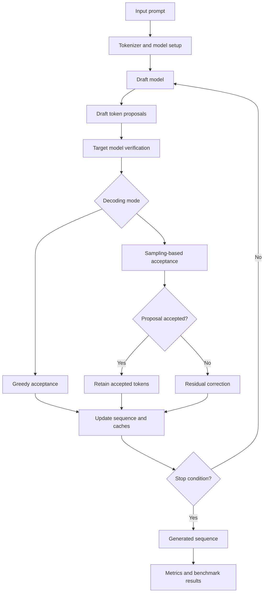
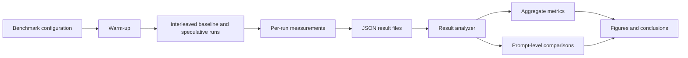
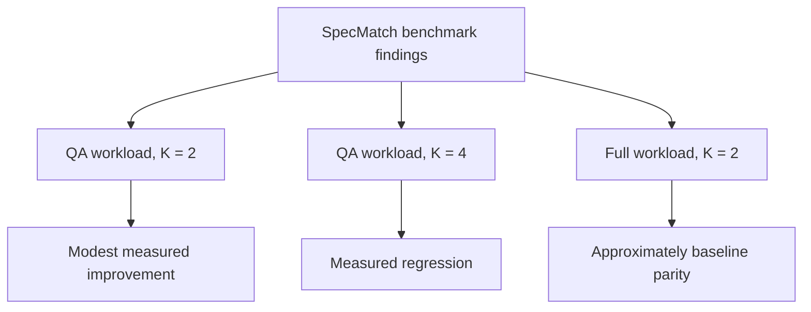

# SpecMatch

### A From-Scratch Speculative Decoding Engine for Causal Language Models

SpecMatch is an experimental speculative decoding engine built to investigate when a smaller draft language model can accelerate autoregressive generation by proposing tokens that a larger target model verifies together.

The project implements draft proposal, target verification, greedy acceptance and rejection, sampling-based acceptance, residual resampling, KV-cache management, benchmark measurement, and result analysis.

Rather than treating speculative decoding as a black-box optimization, SpecMatch focuses on algorithmic implementation, correctness, measurement reliability, and understanding why speculative decoding sometimes fails to improve performance.

| Detail | Configuration |
|---|---|
| Target model | GPT-2 |
| Draft model | DistilGPT-2 |
| Accelerator experiments | Intel Arc XPU, float32 |
| Frameworks | PyTorch and Hugging Face Transformers |
| Repository | [Anirudh2627/Specmatch](https://github.com/Anirudh2627/Specmatch) |

---

## Table of Contents

- [Overview](#overview)
- [Why Speculative Decoding?](#why-speculative-decoding)
- [Features](#features)
- [Architecture](#architecture)
- [How Speculative Decoding Works](#how-speculative-decoding-works)
- [Architectural Decisions](#architectural-decisions)
- [Engineering Challenges](#engineering-challenges)
- [Benchmarking Methodology](#benchmarking-methodology)
- [Experimental Results](#experimental-results)
- [Project Structure](#project-structure)
- [Installation](#installation)
- [Usage](#usage)
- [Running Benchmarks](#running-benchmarks)
- [Analyzing Results](#analyzing-results)
- [Testing and Validation](#testing-and-validation)
- [Limitations](#limitations)
- [Future Work](#future-work)
- [References](#references)
- [License](#license)

---

## Overview

Autoregressive language models generate text one token at a time. Each generated token generally requires another target-model forward pass, creating a sequential generation bottleneck.

Speculative decoding attempts to reduce this bottleneck by introducing a smaller draft model. The draft model proposes several tokens, and the target model evaluates those proposals together. Valid proposals can be accepted without requiring an independent target-model generation pass for each token.

The main workflow is:

1. Use a smaller draft model to propose candidate tokens.
2. Evaluate the proposed sequence using the target model.
3. Accept valid proposals according to the decoding algorithm.
4. If a proposal is rejected, generate a correction token using the appropriate rule.
5. Update the sequence and model caches.
6. Repeat until generation finishes.

The difficult part is not merely generating multiple tokens. Acceptance decisions, probability distributions, cache positions, stopping conditions, and benchmark measurements must remain consistent.

### Project goals

- Implement speculative decoding without delegating the entire algorithm to a built-in assisted-generation implementation.
- Support greedy and sampling-based decoding.
- Handle target and draft KV caches.
- Measure throughput, latency, acceptance rates, and speedup.
- Investigate how speculative-token count and prompt characteristics affect performance.
- Build a reproducible experimental codebase with automated tests and saved benchmark results.

---

## Why Speculative Decoding?

Standard autoregressive generation follows this pattern:

```text
Prompt
  |
  v
Target model
  |
  v
Generate one token
  |
  v
Update context and cache
  |
  v
Target model again
  |
  v
Generate the next token
```

Speculative decoding changes the execution pattern:

```text
Prompt
  |
  v
Draft model
  |
  v
Propose multiple tokens
  |
  v
Target model verifies proposals
  |
  v
Accept valid proposals
or correct a rejection
  |
  v
Update sequence and caches
  |
  v
Continue generation
```

The potential advantage comes from evaluating several candidate positions in one target-model forward pass.

However, speculative decoding is not automatically faster. The result depends on:

- Draft-model inference cost.
- Target-model inference cost.
- Acceptance rate.
- Number of speculative tokens.
- Prompt and output lengths.
- Model architecture and cache behavior.
- Hardware and precision.
- Runtime overhead and synchronization.

SpecMatch measures these trade-offs rather than assuming that a high acceptance rate guarantees faster generation.

---

## Features

| Component | Responsibility |
|---|---|
| Baseline generation | Autoregressive generation using the target model |
| Draft generation | Proposes candidate tokens using a smaller model |
| Target verification | Evaluates candidate tokens using the target model |
| Greedy decoding | Supports deterministic acceptance and rejection |
| Sampling-based decoding | Implements probability-based acceptance and correction |
| Residual resampling | Samples a correction token after rejection |
| KV-cache management | Maintains cache consistency as generation advances |
| Benchmark harness | Runs baseline and speculative experiments |
| Benchmark metrics | Calculates throughput, latency, acceptance, and speedup |
| Result analysis | Examines aggregate and prompt-level performance |
| Automated tests | Validate important algorithmic and infrastructure behavior |

---

## Architecture

The architecture below shows the high-level generation and evaluation flow.



### Benchmark and analysis architecture



### Main execution stages

1. **Model initialization:** Load the target and draft models, configure the tokenizer, select the execution device, and prepare the generation configuration.
2. **Draft proposal:** The draft model proposes a configurable number of candidate tokens, represented by `K`.
3. **Target verification:** The target model evaluates the proposed sequence and supplies distributions needed for acceptance decisions.
4. **Acceptance and correction:** The algorithm determines which proposals can be retained. If a proposal is rejected, the decoding mode determines how the next token is produced.
5. **Cache management:** The sequence and KV caches must correspond to the tokens actually consumed by the generation process.
6. **Termination:** Generation stops when the configured output limit or another supported stopping condition is reached.

---

## How Speculative Decoding Works

### 1. Draft token generation

Let the current context be \(x\). The draft model proposes \(K\) tokens:

$$
y_1, y_2, \ldots, y_K
$$

Each proposal is generated according to the draft model's distribution for the current context, conditioned on previously proposed tokens.

### 2. Target-model verification

The target model evaluates the proposed sequence and provides the corresponding target distributions:

$$
p_1, p_2, \ldots, p_K
$$

The draft model provides the proposal distributions:

$$
q_1, q_2, \ldots, q_K
$$

The target model can evaluate multiple candidate positions in one forward pass, subject to the model's attention mask and cache configuration.

### 3. Greedy acceptance

In greedy decoding, the target model's preferred token at each position is compared with the corresponding draft proposal.

A proposal is accepted when it matches the target model's greedy choice at that position. The algorithm retains the valid prefix and handles a mismatch according to the implementation's correction and cache-update rules.

### 4. Sampling-based acceptance

For sampling-based speculative decoding, matching the target model's most likely token is not sufficient. The goal is to preserve the target model's sampling distribution.

For a proposed token \(y_i\), the acceptance probability is:

$$
\alpha_i =
\min\left(1,\frac{p_i(y_i)}{q_i(y_i)}\right)
$$

The proposal is accepted with probability \(\alpha_i\).

This rule accounts for differences between the draft and target distributions.

### 5. Residual resampling

If a draft proposal is rejected, the algorithm must produce a correction token according to the target distribution after accounting for the draft proposal.

The residual distribution is:

$$
r_i(v) \propto \max(0,p_i(v)-q_i(v))
$$

When the residual has positive total mass, it is normalized and used to sample the correction token.

This correction step is essential. Simply discarding a rejected token and sampling an arbitrary replacement would not, in general, preserve the target model's intended distribution.

### 6. Cache consistency

KV-cache management is a correctness requirement, not merely a performance optimization.

Important considerations include:

- Correct cache positions.
- Correct handling of accepted prefixes.
- Cache truncation after rejected proposals.
- Avoiding stale cached tokens.
- Maintaining consistency between generated tokens and consumed context.
- Handling stopping conditions and output-length boundaries.

Incorrect cache handling can produce incorrect generation even when the acceptance logic is otherwise sound.

---

## Architectural Decisions

### Implement the decoding logic directly

The project implements the speculative decoding workflow explicitly so that acceptance, correction, and cache behavior can be inspected and tested.

### Separate generation from benchmarking

Generation logic, benchmark orchestration, metrics, and result analysis are separated into different modules. This makes it easier to change measurement methodology without unnecessarily changing the decoding algorithm.

### Support greedy and sampling-based decoding

Greedy decoding provides a deterministic starting point for studying the algorithm. Sampling-based decoding introduces probability-based acceptance and residual correction, requiring additional attention to distributional correctness.

### Treat KV-cache management as a correctness requirement

The cache must represent the correct consumed context after acceptance or rejection. Cache behavior is tested independently where possible, rather than relying exclusively on end-to-end generation.

### Synchronize accelerator execution around timing

Accelerator operations can be asynchronous. Timing without synchronization can measure submission overhead rather than completed computation. The benchmark implementation synchronizes supported accelerator execution around measured generation.

### Warm up generation paths before measurement

Warm-up runs help reduce the influence of initialization and first-run overhead on recorded measurements.

### Interleave baseline and speculative measurements

Measuring every baseline run first and every speculative run afterward can introduce bias from changing runtime conditions. The benchmark interleaves the two modes and alternates their order where applicable.

### Report aggregate and per-run metrics

Aggregate throughput is calculated as:

```math
T_{\mathrm{aggregate}} = \frac{\sum_i N_i}{\sum_i t_i}
```

Here, \(N_i\) is the number of generated tokens and \(t_i\) is the measured wall time for run \(i\).

This differs from the arithmetic mean of individual-run throughput values. Both can be useful, but they answer different questions.

### Compare configurations using matched prompts

Prompt-level comparisons help identify whether speculative decoding benefits particular workloads while slowing down others. When comparison metadata is available, baseline and speculative records are paired by prompt and repetition with the relevant speculative-token count.

Legacy multi-K results without this metadata are not used for ambiguous paired comparisons.

### Reset accelerator peak-memory counters

The benchmark resets supported accelerator peak-memory counters before individual measured runs so that earlier measurements do not contaminate the reported peak.

### Keep results as structured artifacts

Benchmark results are stored as JSON so measurements can be analyzed without rerunning the models. Generated figures summarize throughput, latency, and per-prompt speedup.

---

## Engineering Challenges

### Asynchronous accelerator timing

Accelerator operations may execute asynchronously. Without synchronization, recorded wall time may not represent completed generation.

**Approach:** Synchronize supported accelerator execution around timed regions.

### Measurement variability

Individual runs can vary because of runtime conditions, initialization effects, and prompt-specific behavior.

**Approach:** Warm up generation paths, repeat measurements, and interleave baseline and speculative runs.

### Misleading average throughput

A simple average of individual throughput values can tell a different story from total tokens divided by total elapsed time.

**Approach:** Report aggregate throughput alongside mean throughput and latency percentiles.

### Comparing multiple speculative-token counts

A baseline measurement should not be silently compared against multiple speculative configurations as though every pairing were independently measured.

**Approach:** Use explicit `comparison_K` metadata when available and refuse ambiguous paired analysis for legacy multi-K results.

### Acceptance rate versus speed

A higher acceptance rate does not guarantee higher throughput. Drafting, verification, cache management, and runtime overhead all contribute to total generation cost.

**Approach:** Evaluate end-to-end performance alongside acceptance statistics.

---

## Benchmarking Methodology

The project records baseline and speculative generation measurements using a benchmark harness.

### Measurement principles

- Use the same prompts for comparable baseline and speculative runs.
- Keep generation limits consistent.
- Record the target and draft model configurations.
- Warm up requested execution paths.
- Interleave baseline and speculative measurements when practical.
- Repeat measurements.
- Synchronize accelerator execution around timed regions.
- Save raw measurements as JSON.
- Analyze aggregate performance and individual prompt outcomes.
- Avoid combining absolute throughput values from separate sessions without controlling execution conditions.

### Metrics

**Aggregate throughput**

```math
T_{\mathrm{aggregate}} = \frac{\sum_i N_i}{\sum_i t_i}
```

**Mean throughput**

The arithmetic mean of the individual run-throughput measurements.

**Median latency (p50)**

The median measured generation latency.

**95th-percentile latency (p95)**

The latency below which 95% of measured runs fall.

**Acceptance rate**

The fraction of draft proposals accepted by the target verification procedure, according to the benchmark's recorded metric definition.

**Tokens per target forward pass**

A measure of how many output tokens are produced relative to target-model forward-pass usage. This helps characterize the computational benefit of verification, but does not by itself determine wall-clock speed.

**Paired speedup**

For a matched baseline and speculative run:

$$
S_i =
\frac{t_{\mathrm{baseline},i}}
{t_{\mathrm{speculative},i}}
$$

A value above \(1\) indicates lower speculative latency for that pair. A value below \(1\) indicates that the speculative run was slower.

**Aggregate speedup**

When the compared runs use compatible workloads and measurement conditions, aggregate speedup can be calculated from their aggregate throughput values:

```math
S_{\mathrm{aggregate}} = \frac{T_{\mathrm{speculative}}}{T_{\mathrm{baseline}}}
```

A value above \(1\) indicates higher speculative throughput.

---

## Experimental Results

The experiments below are from the saved benchmark artifacts in this repository. Results are specific to the recorded environment and workloads; they should not be interpreted as universal performance claims.

### Experiment E: QA workload, K = 2

| Metric | Baseline | Speculative |
|---|---:|---:|
| Aggregate throughput | 73.81 tokens/s | 77.17 tokens/s |
| p50 latency | 0.82 s | 0.80 s |
| p95 latency | 1.08 s | 0.97 s |

Additional recorded observations:

- Draft acceptance rate: approximately 77.9%.
- Tokens per target forward pass: approximately 2.44.
- Paired median speedup: approximately 1.046x.
- Speculative runs faster in 9 of 15 paired comparisons.

**Interpretation:** This small QA workload showed a modest throughput improvement. The sample is limited, so it is evidence for this configuration rather than proof of a general speedup.

### Experiment F: QA workload, K = 4

| Metric | Baseline | Speculative |
|---|---:|---:|
| Aggregate throughput | 43.602 tokens/s | 40.745 tokens/s |

Additional recorded observations:

- Draft acceptance rate: approximately 59.6%.
- Tokens per target forward pass: approximately 3.197.
- Mean paired speedup: approximately 0.947x.

**Interpretation:** Increasing the speculative-token count to four did not improve end-to-end performance in this experiment. The lower acceptance rate and additional draft/verification overhead are relevant factors.

### Experiment G: Full workload, K = 2

| Metric | Baseline | Speculative |
|---|---:|---:|
| Aggregate throughput | 76.53 tokens/s | 75.71 tokens/s |
| Mean throughput | 76.79 tokens/s | 76.65 tokens/s |
| p50 latency | 0.817 s | 0.829 s |
| p95 latency | 0.938 s | 0.992 s |

Additional recorded observations:

- Draft acceptance rate: approximately 75.58%.
- Paired median speedup: approximately 1.001x.
- Speculative runs faster in 31 of 60 paired comparisons.
- Aggregate throughput speedup: approximately 0.989x.
- Median latency speedup: approximately 0.985x.

**Interpretation:** On the full workload, K = 2 was effectively at parity with baseline generation, with a small aggregate throughput regression. The results do not support claiming a general speedup.

### Results at a glance



### Figures

The repository includes the following generated figures:

- `reports/figures/xpu_aggregate_throughput.png`
- `reports/figures/xpu_latency.png`
- `reports/figures/xpu_per_prompt_speedup.png`

These figures visualize aggregate throughput, latency, and prompt-level speedup.

### Interpreting these results responsibly

- Experiments E, F, and G were run in separate sessions. Do not directly compare their absolute throughput values as if they were collected under one controlled session.
- Experiment E used a small QA workload, so its apparent improvement may not generalize.
- Experiment F shows that increasing `K` does not necessarily improve throughput.
- Experiment G is the broader full-workload measurement and shows near parity with a slight regression.
- Older K-sweep results without `comparison_K` metadata can be summarized, but ambiguous paired comparisons should be withheld.
- A meaningful performance claim requires repeated, controlled measurements on the same workload and hardware.

The main result is not that speculative decoding always wins. It is that the project measures where its overhead is worthwhile and where it is not.

---

## Project Structure

The following tree highlights the main project components and experiment artifacts.

```text
Specmatch/
├── src/
│   └── specmatch/
│       ├── speculative.py
│       ├── generate.py
│       ├── benchmark.py
│       └── metrics.py
├── scripts/
│   ├── benchmark.py
│   ├── run_baseline.py
│   ├── run_speculative.py
│   └── analyze_benchmark.py
├── tests/
│   ├── test_benchmark.py
│   ├── test_cache.py
│   ├── test_metrics.py
│   └── ...
├── notebooks/
│   ├── 01_sanity_checks.ipynb
│   ├── 02_acceptance_rate.ipynb
│   ├── 03_draft_model_comparison.ipynb
│   ├── 04_speed_benchmark.ipynb
│   └── 05_results_analysis.ipynb
├── benchmarks/
│   └── results/
│       ├── expA_xpu_float32.json
│       ├── expB_qa_K_sweep_xpu_float32.json
│       ├── expC_full_K2_xpu_float32.json
│       ├── expD_interleaved_qa_K2_xpu_float32.json
│       ├── expE_interleaved_qa_K2_xpu_float32.json
│       ├── expF_interleaved_qa_K4_xpu_float32.json
│       └── expG_interleaved_full_K2_xpu_float32.json
├── reports/
│   └── figures/
│       ├── xpu_aggregate_throughput.png
│       ├── xpu_latency.png
│       └── xpu_per_prompt_speedup.png
├── README.md
└── ...
```

The tree is representative rather than a complete listing of every file. The `...` entries indicate additional files in the repository.

### Important modules

| Path | Purpose |
|---|---|
| `src/specmatch/speculative.py` | Speculative decoding algorithm |
| `src/specmatch/generate.py` | Generation utilities and execution handling |
| `src/specmatch/benchmark.py` | Benchmark orchestration |
| `src/specmatch/metrics.py` | Metric calculations |
| `scripts/benchmark.py` | Command-line benchmark runner |
| `scripts/run_baseline.py` | Baseline generation entry point |
| `scripts/run_speculative.py` | Speculative generation entry point |
| `scripts/analyze_benchmark.py` | Analyze saved benchmark result files |
| `tests/` | Automated correctness and regression tests |
| `notebooks/` | Sanity checks and experimental analysis |
| `benchmarks/results/` | Saved JSON measurements |
| `reports/figures/` | Generated benchmark plots |

---

## Installation

### Requirements

- Python compatible with the installed project dependencies.
- PyTorch.
- Hugging Face Transformers.
- The other dependencies declared by the repository.
- Internet access on the first run if the required models are not cached locally.

The project has been tested with an Intel Arc XPU environment. Device availability depends on the installed PyTorch build and supported Intel GPU software stack.

### 1. Clone the repository

```bash
git clone https://github.com/Anirudh2627/Specmatch.git
cd Specmatch
```

### 2. Create and activate a virtual environment

**Windows PowerShell**

```powershell
python -m venv .venv
.\.venv\Scripts\Activate.ps1
```

**Linux**

```bash
python -m venv .venv
source .venv/bin/activate
```

### 3. Install dependencies

Install the project dependencies using the repository's dependency file and instructions.

For example, if the repository contains `requirements.txt`:

```bash
pip install -r requirements.txt
```

If the repository does not contain `requirements.txt`, use its actual dependency configuration instead. Do not create a dependency file by guessing package versions.

### 4. Verify PyTorch and XPU availability

```python
import torch

print("PyTorch:", torch.__version__)
print("XPU available:", hasattr(torch, "xpu") and torch.xpu.is_available())
```

If XPU is unavailable, check the installed PyTorch build and Intel GPU runtime configuration before running accelerator experiments.

Do not replace a working XPU-enabled PyTorch environment with a CPU-only build just to make the check pass.

---

## Usage

The repository includes separate entry points for baseline generation and speculative generation.

Check the current command-line options first:

```bash
python scripts/run_baseline.py --help
```

```bash
python scripts/run_speculative.py --help
```

### Run baseline generation

Example using GPT-2 on XPU with float32:

```powershell
python scripts/run_baseline.py `
  --model gpt2 `
  --prompt "The three laws of robotics are" `
  --max-new-tokens 16 `
  --device xpu `
  --dtype float32
```

The backtick (`) is a PowerShell line-continuation character. In other shells, use their supported continuation syntax or run the command on one line.

### Run speculative generation

Check the exact arguments supported by the current entry point:

```bash
python scripts/run_speculative.py --help
```

Use the displayed options to configure the target model, draft model, speculative-token count, device, precision, prompt, and output length as supported by the checked-out version.

### Model downloads

The first run may download model weights from Hugging Face. A Hugging Face token may be useful for rate-limited requests, but GPT-2 and DistilGPT-2 are public models.

---

## Running Benchmarks

The benchmark CLI supports baseline, speculative, and combined measurements.

Inspect the available options:

```bash
python scripts/benchmark.py --help
```

The interface includes options for:

- `--mode` with baseline, speculative, or both.
- `-K` to specify one or more speculative-token counts.
- `--device` to select the execution device.
- `--dtype` to select the supported precision.
- `--out` to choose the output JSON file.

### Example: baseline and speculative comparison

```powershell
python scripts/benchmark.py `
  --mode both `
  -K 2 `
  --device xpu `
  --dtype float32 `
  --out benchmarks/results/my_experiment.json
```

This example uses PowerShell line-continuation syntax. If the current version requires additional arguments, such as prompt selection or output length, supply them according to `python scripts/benchmark.py --help`.

### Example: compare speculative-token counts

```powershell
python scripts/benchmark.py `
  --mode both `
  -K 2 4 `
  --device xpu `
  --dtype float32 `
  --out benchmarks/results/k_sweep.json
```

Use a controlled workload and retain the resulting JSON files so the comparison can be reproduced.

### Recommended experimental procedure

1. Choose a fixed set of prompts.
2. Keep the target model, draft model, output length, device, and precision unchanged.
3. Run warm-up iterations.
4. Measure baseline and speculative generation in an interleaved order.
5. Repeat the experiment enough times to characterize variability.
6. Save the raw measurements.
7. Analyze throughput, latency, acceptance, and matched prompt-level speedup.
8. Report regressions as well as improvements.

---

## Analyzing Results

The result analyzer accepts saved benchmark JSON files.

Inspect its options:

```bash
python scripts/analyze_benchmark.py --help
```

Analyze a single result file:

```bash
python scripts/analyze_benchmark.py benchmarks/results/expG_interleaved_full_K2_xpu_float32.json
```

The analyzer is designed to help inspect:

- Aggregate baseline and speculative throughput.
- Latency and speedup summaries.
- Per-prompt comparisons.
- Results grouped by speculative-token count.
- Whether the saved metadata supports valid paired comparisons.

### Why comparison metadata matters

When a benchmark contains multiple speculative-token counts, a baseline record must be associated with the appropriate comparison configuration to support a fair paired analysis.

The `comparison_K` field records this association for the relevant benchmark records. If older files do not contain sufficient metadata, the analyzer avoids making ambiguous paired comparisons across multiple K values.

This is preferable to reporting a misleading speedup derived from unrelated measurements.

### Saved experiment artifacts

The repository includes JSON results for the experiments named below:

| Experiment | Workload / purpose |
|---|---|
| Experiment A | XPU float32 baseline experiment |
| Experiment B | QA speculative-token-count sweep |
| Experiment C | Full workload with K = 2 |
| Experiment D | Interleaved QA workload with K = 2 |
| Experiment E | Interleaved QA workload with K = 2 |
| Experiment F | Interleaved QA workload with K = 4 |
| Experiment G | Interleaved full workload with K = 2 |

Use the individual JSON files as the source of truth for exact prompts, repetitions, and recorded metrics.

---

## Testing and Validation

The project uses `pytest` to validate decoding behavior, cache handling, benchmark metrics, and related functionality.

Run the test suite from the repository root:

```bash
python -m pytest
```

The latest recorded test run during this development stage was:

```text
54 passed, 1 warning
```

This result describes that recorded run, not a guarantee that every environment or future revision will produce the same outcome.

### Important validation areas

- Benchmark summary calculations.
- Aggregate throughput and speedup calculations.
- Cache-management behavior.
- Acceptance and correction logic.
- Handling of different speculative-token counts.
- Result-analysis behavior when comparison metadata is missing.
- Regression tests for previously identified issues.

### Check whitespace and patch formatting

Before committing changes, a useful Git check is:

```bash
git diff --check
```

This helps detect whitespace errors in the current diff.

---

## Limitations

SpecMatch is an experimental implementation and benchmarking project. Its results should be interpreted within the constraints of its current models, hardware, and workloads.

### Performance is workload-dependent

The draft model introduces its own inference cost. If the target model is relatively small or the draft acceptance rate is low, that extra cost may eliminate the expected benefit.

### Acceptance rate is not a speed metric

A high acceptance rate can coexist with a throughput regression. End-to-end wall-clock measurements remain necessary.

### Small workloads have limited statistical strength

A modest improvement on a small prompt set is not enough to establish a general performance advantage. Larger workloads and repeated controlled experiments are needed.

### Hardware-specific results

The recorded experiments use Intel Arc XPU and float32. Results may differ on CPUs, NVIDIA GPUs, other accelerators, and different software stacks.

### Separate sessions are not directly interchangeable

Throughput from experiments run in separate sessions should not be compared as if all environmental conditions were identical.

### Model and workload scope

The current project focuses on a limited target/draft model pairing and a set of experimental workloads. It does not establish performance for every language model or serving environment.

### Not a production serving stack

SpecMatch is focused on the decoding algorithm and its evaluation. Production serving would require additional work around concurrency, batching, request scheduling, cancellation, memory management, observability, and deployment.

---

## Future Work

Potential directions for further development include:

- Expand the benchmark matrix across prompt lengths and output lengths.
- Evaluate additional target and draft model pairs.
- Improve statistical reporting with confidence intervals and repeated-run summaries.
- Explore adaptive selection of the speculative-token count.
- Profile draft generation, target verification, cache updates, and sampling overhead separately.
- Investigate batching and concurrent requests.
- Compare performance across supported devices and precisions.
- Add more extensive tests for distributional correctness in sampling-based decoding.
- Improve experiment metadata and reproducibility.
- Explore production-oriented integration with a model-serving runtime.

These are possible extensions, not claims that the features are already implemented.

---

## References

1. Leviathan, Y., Kalman, M., and Matias, Y. **Fast Inference from Transformers via Speculative Decoding.** International Conference on Machine Learning (ICML), 2023. [Paper](https://arxiv.org/abs/2211.17192)
2. Chen, C. et al. **Accelerating Large Language Model Decoding with Speculative Sampling.** [Paper](https://arxiv.org/abs/2302.01318)
3. [PyTorch documentation](https://pytorch.org/docs/stable/index.html)
4. [Hugging Face Transformers documentation](https://huggingface.co/docs/transformers/index)

---

## License

The repository is listed as using the **MIT License**. See the [`LICENSE`](LICENSE) file in the repository for the complete license text.
